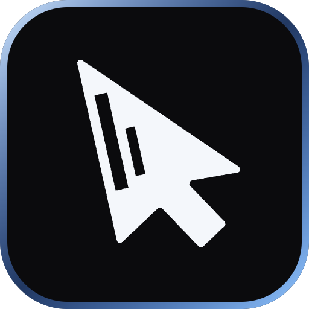

<p align="center">
  <a href="https://glassdesk.dev"></a>
</p>

<h1 align="center">Glass</h1>

<p align="center">
  <strong>Your computer, in any browser.</strong><br>
  A free, open-source remote desktop for <b>macOS</b> and <b>Linux</b> with about <b>20&nbsp;ms</b> of delay.<br>
  Control your Mac from an iPad, iPhone or any laptop. Nothing to install on the device in your hands.
</p>

<p align="center">
  <a href="https://github.com/Ntarasiuk/glass/releases/latest"></a>
  <a href="https://github.com/Ntarasiuk/glass/actions/workflows/ci.yml"></a>
  <a href="LICENSE"></a>
  
  
</p>

<p align="center">
  <a href="https://glassdesk.dev">Website</a> ·
  <a href="https://glassdesk.dev/docs">Docs</a> ·
  <a href="https://glassdesk.dev/features">Features</a> ·
  <a href="#faq">FAQ</a>
</p>

---

```sh
curl -fsSL glassdesk.dev | sh
```

Run that on the computer you want to control. A guided setup connects [Tailscale](https://tailscale.com), installs the background service, checks each permission, then shows a QR code. Scan it with your iPad and you're in. About two minutes, start to finish.

## Why Glass

Most remote desktops ride the same pipeline as video calls, which buffers frames so motion looks smooth. That's fine for watching. It's wrong for typing, dragging and scrolling, where every buffered frame is lag you feel.

Glass is built like a game stream instead: hardware H.264 straight from the encoder, sent as unreliable QUIC datagrams so a lost packet never holds up a newer frame, decoded by the browser's hardware decoder in a worker, and drawn the moment it arrives. No jitter buffer. A live meter shows the real capture-to-display latency, typically **15–30 ms** on a home network or tailnet.

And the viewer is just a web page. No app to install, no account to create.

## Features

### Picture and speed
- **Feels local.** Hardware encode and decode, WebTransport datagrams, no buffering: about 20 ms.
- **Up to 120 fps and true colour.** ProMotion iPads and fast monitors get up to 120 fps; Display P3 from a wide-colour Mac display stays P3.
- **Sharp text.** A per-viewer mode for code and documents: native size, HEVC 4:2:2 while things move, and a lossless full-colour (4:4:4) picture once the screen is still.
- **Every display.** Switch screens from live previews along the bottom, or show them all side by side, arranged like your desk.
- **Your device as a second display.** Turn an iPad or laptop into one more display beside the Mac, Retina and all, like Sidecar with nothing to install. Or reshape the Mac's desktop to fit your screen.
- **Steady on bad Wi-Fi.** Adapts bitrate, reconnects after sleep or tab suspension, never shows a corrupted frame, and asks for a smaller picture when your device struggles.

### Control
- **Full control.** Mouse, trackpad, keyboard, touch and pinch to zoom, or trackpad mode on a phone (drag the pointer, the zoomed view follows it). ⌘Tab works on iPad. Unlock a locked Mac from the lock screen.
- **Apple Pencil.** Pressure and tilt reach the Mac as tablet input, so drawing apps respond as they do to a drawing tablet.
- **Keyboards per machine.** ⌘↔Ctrl, PC-keyboard and ⌘/⌥ swaps remembered for each computer, and a shortcut bar for touch screens.
- **Games.** Capture the mouse (relative motion) for games and 3D apps; game controllers reach Linux hosts.
- **Every machine.** All your computers in one menu; wake sleeping ones (Wake-on-LAN), restart Glass or the whole computer and reconnect.

### Between your devices
- **Your microphone on the computer.** Talk into its apps from your iPad or phone. On a Mac it comes in as Glass Microphone, our own small audio driver (`glass mic install`, one password); on Linux through PipeWire or PulseAudio, nothing to install.
- **Sound, clipboard, files.** System audio (your browser's media controls show what's playing, with artwork, and control it), copy and paste both ways (text, rich text and images), and direct transfer of files and whole folders.
- **A file browser.** Browse the computer's folders with previews, download, upload into any folder, rename and move to the Trash (owner only).
- **Share to your computer.** Share photos, files or links to Glass from other apps.

### On every device
- **Just a browser.** iPad, iPhone, Android, Mac, Windows or Linux. Nothing to install on the device in your hands.
- **An app when you want one.** Install it from the browser or the Home Screen: full screen, a badge, a shortcut to each machine, picture in picture, the toolbar in the title bar on desktops, and it opens even when the computer is asleep.
- **Notifications.** When an agent needs you, someone asks to connect (allow or deny from the notification), or a message comes, even with Glass closed. Encrypted end to end (`glass notifications`).

### Helping someone
- **Quick support.** Someone without Glass runs `curl -fsSL glassdesk.dev/help | sh` and reads you a code; you type it at glassdesk.dev/help and connect once they allow it. Nothing stays installed when they stop.
- **Links that work once.** Let a phone or a friend's laptop in without sharing a password. Each device gets its own pass; `glass link --revoke` cuts them all off.
- **Links with limits.** `--view-only`, `--no-files`, `--no-clipboard`, `--for 1h`, `--ask` (the person at the computer allows each connection) and `--passkey` (Face ID, Touch ID or a security key every time).
- **Chat, drawing and a privacy screen.** Message everyone connected (the conversation is in the Mac app too), draw on the screen, and blank the computer's own screen while you work.
- **From anywhere.** `glass link --anywhere` connects any browser straight to your computer over WebRTC: end-to-end encrypted, no ports opened, no Tailscale needed on the viewer.
- **Your computers, at one address.** Sign in at glassdesk.dev/computers with a passkey (no email, no password) to see which of your computers are online and open any of them from any device. `glass account add` puts a computer there; the account only lists computers, so getting in still takes the computer's own sign-in.

### AI agents
- **Let an agent drive, supervised.** `glass mcp` gives Claude Code (or any MCP client) the screens, pointer and keyboard of every computer on your tailnet running Glass. Add it to Claude Code, Claude Desktop or Cursor in one click from the Mac app. You watch every step, pause or stop it, approve anything risky from your phone, and hand it a 2FA code when it's stuck.
- **Agents from anywhere.** An agent on Vercel, in claude.ai or on a server asks to use your computer through standard MCP sign-in (works with Vercel Connect). You approve it once with one tap; then it works with no prompts, can't touch passwords or security settings, waits while you're using the computer, and every step is logged. Revoke it any time.
- **Agent-ready setup.** Ask Claude Code to "set up Glass on my Mac mini" and it does it over SSH ([skill](#set-up-with-an-ai-agent)).

### The Mac app, the console and the command line
- **A real Mac app.** Glass.app does everything the CLI does in a native, GPU-drawn window: setup in a few clicks, who's connected and chat, links with QR codes, machines, history, AI agents, settings and teams, and a one-click update.
- **A console.** `https://<computer>/admin/`: who's connected, requests to allow, links, devices, history, settings, access rules, and an address book of your machines.
- **Beyond the desktop.** Stream a single app's window, a resizable full-screen terminal in the viewer, local web ports (`/fwd/3000/`) from your tailnet, and recording to MP4.

### Teams and security
- **Private by default.** On your tailnet, your devices get in and nothing else does. Runs as your user, never root.
- **Single sign-on.** Google, Entra, Okta or any OpenID Connect provider, or LDAP. Access rules (`glass acl`) per email, domain or group; SCIM provisioning cuts off deactivated accounts.
- **Device posture.** Require a Tailscale tag, certain operating systems, a minimum browser version, or passkeys with Face ID / Touch ID / a PIN.
- **Self-hostable relay.** Run the WebRTC introducer and TURN yourself ([site/selfhost](site/selfhost)) and point Glass at it with `glass config relay`.

## How it compares

| | Glass | Chrome Remote Desktop | Parsec, Moonlight, Jump Desktop | VNC / Screen Sharing |
|---|---|---|---|---|
| Viewer | Any browser | Any browser | Mostly native apps | Native app (or noVNC) |
| Pipeline | Game-stream style, no jitter buffer | Video-call (WebRTC) | Game-stream style | Pixel diffs |
| Mac and Linux hosts | ✅ (Linux beta) | ✅ | Varies | ✅ |
| Open source | ✅ MIT | ❌ | Moonlight + Sunshine only | Varies |
| Account required | No | Google | Usually | No |

## Install

**Host** (the computer you control):

- macOS 13 Ventura or newer, Apple Silicon or Intel.
- Linux x86_64 on Wayland with PipeWire (beta). Built on Hyprland/Omarchy; works on GNOME and KDE. Arch, Fedora 40+, Ubuntu 24.04+.

```sh
curl -fsSL glassdesk.dev | sh   # installs to ~/.glass, verifies the checksum, opens the Glass app to set up
```

Run it again any time to update. Prefer to read it first? [install.sh](site/public/install.sh). Release tarballs are on the [releases page](https://github.com/Ntarasiuk/glass/releases).

**Viewer:** any browser with WebTransport and WebCodecs: Safari 26.4+ (iPad, iPhone, Mac), Chrome, Edge or Firefox.

## Usage

```sh
glass app                # the Glass app (macOS): setup, connections, links, agents, settings
glass setup              # guided setup: Tailscale, background service, permissions, QR code
glass status             # running? capturing? permissions? connect URL
glass restart            # restart the background service
glass link               # one-time link + QR code for another device
glass link --anywhere    # the same, from any network (WebRTC, end-to-end encrypted)
glass link --view-only --no-files --for 1h   # limited access
glass link --ask --passkey                   # asks you first; needs a passkey every time
glass link --list        # devices let in by links (with ids)
glass link --revoke [id] # cut off one device, or every device let in by a link
glass remote off         # turn off access from outside your tailnet
glass account add        # one-time link that puts this computer on your glassdesk.dev/computers account
glass account remove     # take this computer off every account
glass viewers / kick     # who's connected now; end a session
glass requests / allow / deny   # answer connection requests (glass config ask-guests on)
glass chat "be right there"     # message everyone viewing
glass privacy on|off     # blank this screen and block local input while viewed
glass log                # connection history
glass wake <name|mac>    # Wake-on-LAN
glass config oidc-issuer https://accounts.google.com   # single sign-on (+ oidc-client-id,
                         # oidc-client-secret, oidc-allow ana@x.com,@corp.com, oidc-scope)
glass config ldap-url ldaps://dir.example.com          # directory sign-in (+ ldap-user-dn
                         # uid={user},ou=people,dc=example,dc=com, or ldap-base-dn + ldap-bind-dn)
glass acl add group:eng --view-only --for 8h   # access rules for SSO/LDAP accounts, first match
glass acl add @example.com                     # wins: email, @domain, group:name or *
glass acl / glass acl remove 0                 # list; remove by position
glass config scim-token new   # SCIM provisioning at https://<computer>/scim/v2 (Okta, Entra ID):
                         # deactivated users can't sign in and lose their sessions
glass config             # settings: ask-guests, record, privacy, hevc, forward-ports, name, accent, relay…
glass mcp                # MCP server: an AI agent uses this computer while you watch
                         # (claude mcp add glass -- glass mcp; --machine mac-mini for another)
glass agents             # agents from anywhere: list, revoke ID|all, install CLIENT, log, verify,
                         # on|off, public on|off (publish with Tailscale Funnel)
glass feedback "…"       # tell us what broke or what you want
```

On your tailnet, open `https://<computer>.<tailnet>.ts.net` on the iPad. Full CLI reference, Sharp text, the console, team sign-in, keyboard tips for iPad and troubleshooting: [glassdesk.dev/docs](https://glassdesk.dev/docs).

## Set up with an AI agent

Glass ships an [agent skill](skills/glass/SKILL.md). With it, Claude Code finds a machine on your tailnet, installs Glass over SSH, runs the unattended setup, tells you which permission switch to click on that machine's screen, and verifies the connection.

```sh
mkdir -p ~/.claude/skills/glass && curl -fsSL https://glassdesk.dev/skill.md -o ~/.claude/skills/glass/SKILL.md
```

Then ask: *"set up Glass on my Mac mini"*. Scripts can use the same commands: `glass setup --yes --json` and `glass status --json`.

## How it works

```
Mac (glass)                                             Browser
ScreenCaptureKit ─▶ VideoToolbox H.264 ─▶ WebTransport ─▶ WebCodecs ─▶ OffscreenCanvas
 (IOSurface,         (hardware,           datagrams        (worker)
  on change)          low-latency RC)     over QUIC
CGEvent ◀───────────── input stream ◀──────────────────── pointer / keyboard / touch
NSPasteboard, files ◀─▶ control + file streams ◀─────────▶ clipboard, uploads, downloads
```

- **Capture** only when the screen changes, zero-copy. A still screen costs nothing.
- **Encode** in hardware, low-latency rate control, no B-frames. Keyframes on demand.
- **Transport:** video and audio as unreliable datagrams; input, clipboard and files on reliable streams. From anywhere, the same over a direct WebRTC connection that the host signs, so the browser refuses anyone else, glassdesk.dev included.
- **Decode** in a Web Worker straight to an OffscreenCanvas; the main thread only handles input.
- **Integrity:** every frame carries a checksum. Corrupted frames are never decoded; the client asks for a keyframe and recovers in a fraction of a second.
- **Linux:** xdg-desktop-portal + PipeWire capture, OpenH264, uinput, wl-clipboard, systemd user service.

| Path | What |
|---|---|
| [`crates/glass-host`](crates/glass-host) | The `glass` binary: WebTransport/HTTPS server, sessions, files, setup. Platform code in `src/macos/` and `src/linux/`. |
| [`crates/glass-proto`](crates/glass-proto) | Wire format, mirrored in `web/proto.js`. |
| [`web`](web) | Browser client. Plain JS, no build step. |
| [`site`](site) | glassdesk.dev: a Cloudflare Worker with D1, plus the WebRTC introducer (a Durable Object). |

## Security and privacy

- Everything is encrypted: TLS 1.3 over QUIC on your tailnet, end-to-end encrypted WebRTC from anywhere.
- A device gets in only if Tailscale says it's yours, or it has the access token or a one-time pass. Nothing is sent until then.
- Narrow it further: limited or passkey-bound links, ask-first, single sign-on or LDAP with access rules, SCIM deprovisioning and device posture checks. Secrets are stored owner-only.
- Remote access from outside your tailnet is off until you make a link or run `glass remote on`.
- Glass runs as your user, never as root. The app sends nothing to glassdesk.dev except feedback you choose to send, and, if you run `glass account add`, this computer's name and public key for your account's list.

Found a security issue? Please open a [private security advisory](https://github.com/Ntarasiuk/glass/security/advisories/new) rather than a public issue.

## FAQ

**Is it free?** Yes, and MIT licensed.

**Do I need an app on the iPad?** No, just Safari. Tailscale is optional when you use `glass link --anywhere`.

**Can Windows be the host?** Not yet. Windows works as a viewer in any modern browser.

**Can I control a locked Mac?** Yes, type your password at the lock screen. After a reboot, FileVault still needs one local login.

**Do updates ask for permissions again?** No: releases are signed with a stable identity, so macOS keeps the grants. A build you made yourself, or Glass run from a terminal (which uses the terminal's permissions), is a different app to macOS and needs its own grant: run `glass setup`.

More in the [docs](https://glassdesk.dev/docs#faq).

## Development

Requirements: macOS 13+, stable Rust, and Node for the site and tests.

```sh
cargo run --release -p glass-host          # serves http://localhost:8080
```

The terminal you run it from needs Screen Recording and Accessibility permission. With Tailscale HTTPS enabled, other tailnet devices can connect at `https://<mac>.<tailnet>.ts.net:8080`. Logs from the host *and* connected browsers land in `logs/`, so you can debug an iPad without a debugger.

```sh
scripts/test.sh                             # everything: Rust, JS, end-to-end, site, Linux (if Docker is running)
scripts/test.sh e2e                         # just the browser end-to-end suite
./scripts/package.sh                        # universal release tarball in dist/
scripts/linux/build.sh [test]               # Linux x86_64 build/tests in an Arch container
cd site && npm install && npm run dev       # site locally (wrangler dev)
```

`glass --test` runs the host with fakes: two 640×360 test-pattern displays, recorded input, an in-memory clipboard and `/test/*` hooks to drop or corrupt frames. It never touches your real screen, so the Playwright suite in `tests/e2e` (real Chrome) covers connection, auth, input, touch, keyboard modes, clipboard, files, audio, display layouts, loss and corruption recovery, reconnects, machine switching and updates. CI runs it on macOS and Linux.

## Contributing

Issues and pull requests are welcome. For anything bigger than a fix, open an issue first so we can agree on the approach. Feedback also works from the app (`glass feedback "…"`) or at [glassdesk.dev](https://glassdesk.dev/features#feedback).

If Glass is useful to you, a ⭐ helps other people find it.

## License

[MIT](LICENSE) © Nathan Tarasiuk
